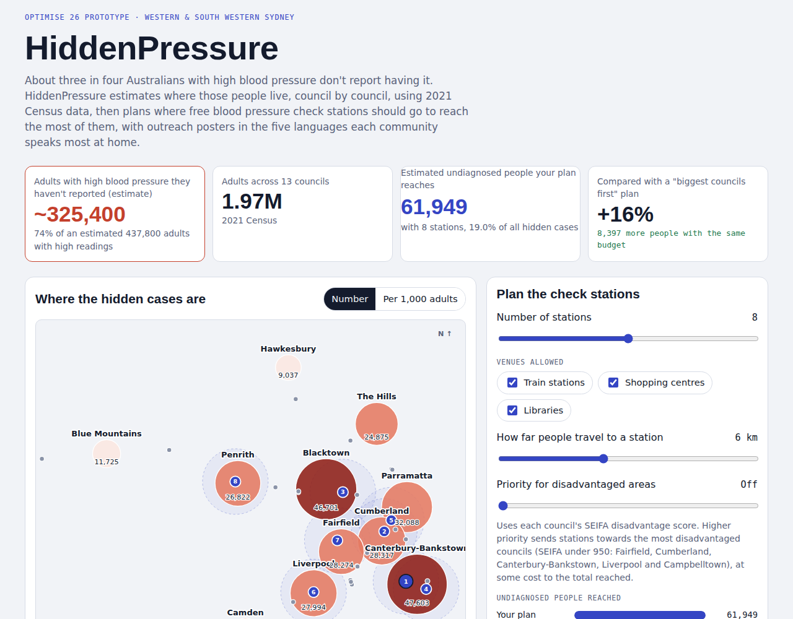

# HiddenPressure 🩺

**Finds where undiagnosed high blood pressure is likely to be in Western and South Western Sydney, and plans where free check stations should go to reach the most of those people.**

**Live demo:** https://reihooneh.github.io/hiddenpressure/ · My main entry for **Optimise 26**, Western Sydney University's student project showcase.



## The problem

High blood pressure causes strokes, heart attacks and kidney failure, usually with no symptoms at all. In Australia, **73.7%** of adults whose blood pressure was high when measured did not report having it (ABS National Health Survey 2017–18). Free blood pressure checks only help if they are placed where those people actually are.

## What it does

1. **Estimates the hidden cases** for 13 councils by combining 2021 Census age groups with ABS rates of measured and unreported high blood pressure by age. That gives about **325,400 adults**, 74% of those with high readings, matching the national figure.
2. **Plans check stations** across 42 real venues (train stations, shopping centres and libraries). Each venue's reach fades with distance, and overlapping stations share people instead of counting them twice. A greedy maximum-coverage optimiser picks the best set.
3. **Lets you change the plan:** the number of stations, which venue types are allowed, how far people travel, and an optional priority for the most disadvantaged councils (SEIFA 2021).
4. **Compares** the plan with a "biggest councils first" plan. With 8 stations, the optimised plan reaches about **61,900** people, **16% more**.
5. **Stress-tests** the plan by re-running it 300 times with each council's estimate, the travel distance and each venue type's reach varied at random. With 8 stations, 5 are chosen in at least 80% of runs.
6. **Makes outreach posters** in each council's five most-spoken home languages (2021 Census). Languages without a checked phrase, such as Assyrian and Chaldean Neo-Aramaic in Fairfield, are flagged for a community translator rather than guessed.

## Run it

It is a single HTML file with no build step. Open `index.html` in a browser, or serve the folder:

```bash
python3 -m http.server 8000      # then open http://localhost:8000
```

## Data

All sources are listed in [data/SOURCES.md](data/SOURCES.md): ABS 2021 Census QuickStats, the ABS National Health Survey 2017–18 and ABS SEIFA 2021. `data/estimate.py` recomputes every council estimate from the published figures and checks that the data inside the app matches:

```bash
python3 data/estimate.py
```

## Tests

```bash
npm install
npx playwright install chromium
npm test
```

`npm test` runs three checks:

- **The data:** `estimate.py` confirms the app's data matches the published sources.
- **The model (31 checks):** the unreported share is within 2 points of the national 73.7%, and the total estimate is in the expected range. For every plan size from 1 to 15 stations, the optimised plan reaches at least as many people as the biggest-councils plan, and adding a station never lowers the number reached.
- **The interface (22 checks):** the headline numbers, every control, and that raising the disadvantage priority reaches more people in the most disadvantaged councils. They also check that the stress test is repeatable, poster languages (including the flagged ones and right-to-left Arabic), table sorting, keyboard use, privacy, security, and phone, tablet and laptop layouts.

CI runs everything on every push and deploys the site to GitHub Pages only if it all passes.

## Security and privacy

- **No personal data at all.** The app works only with published council-level statistics. It has no inputs that accept text, and nothing is stored or sent anywhere.
- **The Content-Security-Policy** sets `connect-src 'none'`, so the page cannot make network requests even if there were a bug. It also blocks plug-ins, `<base>` tags and form posts.
- **No HTML is built from strings:** there is no `innerHTML`, `eval` or `document.write`, and a test checks this.

See [SECURITY.md](SECURITY.md) for how to report a problem.

## Limitations

- **These are model estimates, not people screened.** The model assumes national rates by age apply locally; real rates differ with culture, income and access to care.
- Council-level data is coarse. The next step is suburb-level (SA2) Census tables.
- Venue reach is a simplified model, not measured foot traffic, and venue coordinates are approximate.
- Poster translations are drafts until native speakers check them.

## Licence

MIT. See [LICENSE](LICENSE).
