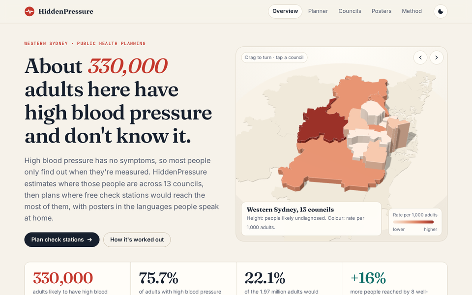
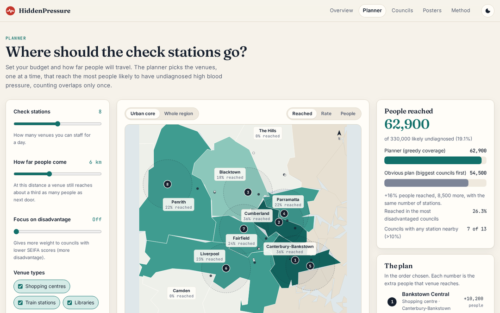

# HiddenPressure 🩺

**Finds where undiagnosed high blood pressure is likely in Western and South Western Sydney, and plans where free check stations would reach the most of those people.**

**Live site:** https://reihooneh.github.io/hiddenpressure/ · My main entry for **Optimise 26**, Western Sydney University's student project showcase.



## The problem

High blood pressure causes strokes, heart attacks and kidney failure, usually with no symptoms. In the ABS National Health Survey 2022, **74.5%** of Australian adults whose blood pressure measured high didn't report having it. Free checks only help if they're placed where those people are.

## The site

| Page | What it does |
|---|---|
| **Overview** | A 3D model of the 13 councils (three.js), raised by the number of people likely to be undiagnosed and coloured by the rate. Then the story in four steps: why it stays hidden (by age), where, where to check, and posters. |
| **Planner** | Choose how many stations, how far people travel, which venue types and how much to favour disadvantaged areas. The map shows the chosen venues, travel rings and the share of each council reached. Plans can be shared as a link, downloaded as CSV and stress-tested. |
| **Councils** | A profile for each council: likely undiagnosed by age, languages spoken at home, SEIFA disadvantage, venues, and a sortable comparison table. |
| **Posters** | A printable A4 poster for any venue or council, in the languages most spoken at home there. |
| **Method** | Every step, a worked example for any council, the reach curve, how overlaps are handled, greedy vs the best possible plan (computed live), checks against the survey, the stress test, limits, sources and a glossary. |



## Key results

- About **330,000 adults** across 13 councils (1.97 million adults) likely have high blood pressure without knowing. That's **75.7%** of those who would measure high, close to the national 74.5%.
- With **8 stations**, the planner reaches about **62,900** of them, **16% more** than putting one station in each of the biggest councils.
- For 1 to 4 stations, greedy matches the best possible plan found by checking every combination (up to 111,930 of them).
- The stress test re-plans 300 times with the inputs shaken: 5 of the 8 picks are chosen in at least 80% of runs.
- Posters flag languages with no checked translation (such as Assyrian and Chaldean in Fairfield) for a community translator instead of guessing.

## How it's built

- **No framework, no tracking, no server.** Plain HTML, CSS and JavaScript modules, built into `site/` by a small Node script.
- **One model for everything** (`site/assets/js/model.js`): the estimates, reach, the greedy optimiser, brute force for checking and the seeded stress test. The pages and the tests import the same file.
- **Real council boundaries** from the ABS (ASGS 2021, CC BY 4.0), simplified to 34 KB.
- **Maps that never overlap.** Labels are placed at run time: each one tries positions around its council, avoiding other labels, station markers, leader lines and the map's edges, and adds a leader line when it has to move. Stations close together are spread apart and pinned to their real spot. Anything that can't fit is listed under the map instead of being drawn on top of something.
- **Self-hosted** fonts (Inter, Fraunces, JetBrains Mono) and three.js, pinned to exact versions, so the page loads nothing from other sites.

## Run it

```bash
npm ci
npm run build     # makes site/ from data/ and src/pages/
npm run serve     # http://127.0.0.1:4173/
```

## Tests

```bash
npx playwright install chromium
npm test
```

- **The data:** `data/estimate.py` recomputes every council from the published figures and checks `data.json`.
- **The model (14 tests):** the unreported share is within 2 points of the national 74.5%; greedy is never worse than the obvious plan for 1 to 15 stations; adding a station never lowers reach; greedy is within 5% of brute force; gains add up with no double counting; the disadvantage focus raises reach where it should; the stress test is reproducible.
- **The site (23 tests):** every page at phone, tablet and desktop sizes with no errors and no sideways scrolling. On every map, no label touches another label or a station marker, or leaves the map, and **no line of text anywhere on the page overlaps another**. Also: the strict CSP, the 3D model and its no-WebGL fallback, every planner control, shared links with bad values, CSV download, the stress test, council choice, sorting and keyboard use, posters and the theme switch.

CI checks that the committed site matches the sources, runs everything, and deploys `site/` to GitHub Pages only if it all passes.

## Security and privacy

- **No personal data.** Only published council-level statistics. Nothing is stored except the light/dark choice, and nothing is sent anywhere.
- **Strict Content-Security-Policy** on every page: scripts, styles and fonts only from this site, no inline code, `connect-src 'none'`, no plug-ins, `<base>` tags or form posts. A test checks every built page.
- **No HTML from strings:** the DOM is built with `textContent` and attributes only, never `innerHTML`.
- **Shared links are validated:** planner settings from the URL are range-checked and fall back to defaults.
- **CSV export** quotes every cell and stops spreadsheet formulas.

See [SECURITY.md](SECURITY.md) to report a problem.

## Limitations

- **Estimates, not people screened.** National rates by age are applied locally; real rates differ with ethnicity, income and access to GPs.
- Council-level data is coarse. The next step is suburb-level (SA2) Census tables.
- Venue reach is a planning assumption, not measured foot traffic.
- Poster translations are drafts until a qualified translator checks them.

## Licence

MIT, see [LICENSE](LICENSE). Council boundaries © Australian Bureau of Statistics, CC BY 4.0. three.js and the fonts keep their own licences (in `site/assets/vendor` and `site/assets/fonts`).
